  

  

  <a href="https://github.com/LixusThinh/DQN_ABR_Project">DQN_ABR_Project</a> ·
  <a href="https://github.com/LixusThinh/abr-content-aware">abr-content-aware</a> ·
  <a href="https://github.com/LixusThinh/dat-san-vn">dat-san-vn</a> (<a href="https://dat-san-vn-eight.vercel.app">live</a>) ·
  <a href="https://github.com/LixusThinh/ble_emergency_app">SOS Mesh</a> ·
  <a href="https://github.com/LixusThinh/xiangqi-arena">xiangqi-arena</a>

